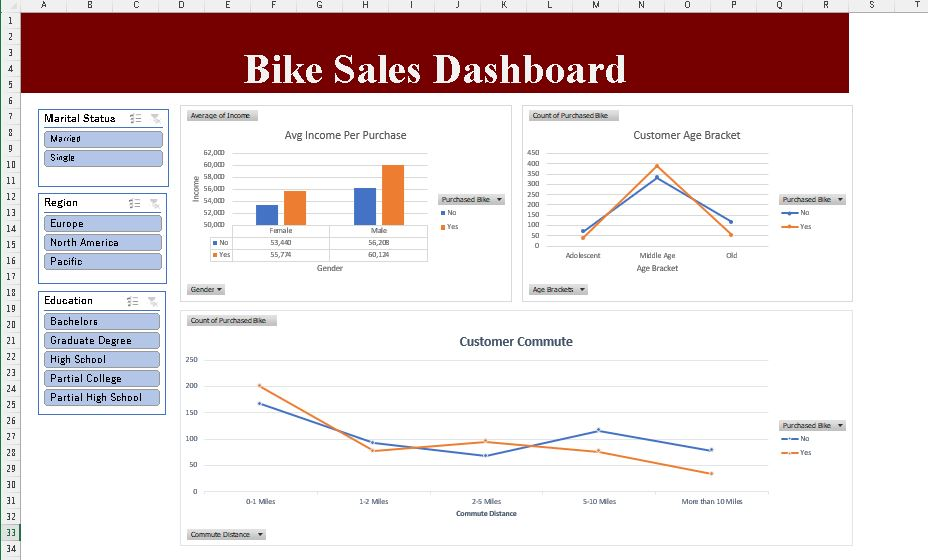

# 🚴 Bike Sales Dashboard (Excel)

A beginner-friendly Excel project that cleans a bike buyers dataset and turns it into an interactive dashboard. It looks at **which customers bought a bike** and how that relates to income, commute distance, and age.



---

## 📁 Project Files

| File | Description |
|------|-------------|
| `Excel_Project.xlsx` | The full workbook (data, pivot tables, and dashboard) |
| `images/dashboard.jpg` | Screenshot of the finished dashboard |

### Sheets inside the workbook

| Sheet | What it contains |
|-------|------------------|
| **Dashboard** | The final dashboard: 3 charts and 3 slicers (Marital Status, Education, Region) |
| **bike_buyers** | The original raw data, left untouched |
| **Pivot Table** | The 3 pivot tables and charts that feed the dashboard |
| **Working Sheet** *(hidden)* | The cleaned copy of the data that the pivot tables are built from |

---

## 📊 About the Data

The dataset has **1,000 customers** and 13 columns:

| Column | Description |
|--------|-------------|
| ID | Customer ID |
| Marital Status | Married / Single |
| Gender | Male / Female |
| Income | Annual income |
| Children | Number of children |
| Education | Education level |
| Occupation | Job category |
| Home Owner | Yes / No |
| Cars | Number of cars owned |
| Commute Distance | Distance to work (0-1 miles up to more than 10 miles) |
| Region | North America / Europe / Pacific |
| Age | Customer age |
| Purchased Bike | Yes / No (the main thing I looked at) |

> **Source:** https://github.com/AlexTheAnalyst/Excel-Tutorial/blob/main/Excel%20Project%20Dataset.xlsx

---

## 🧹 Data Cleaning

All cleaning was done in the **Working Sheet**, so the original `bike_buyers` sheet stays as it was.

1. **Removed duplicates:** the raw sheet had 26 repeated rows (1,026 rows down to 1,000 unique customers).
2. **Made labels readable:** `M`/`S` became *Married*/*Single*, and `M`/`F` became *Male*/*Female*.
3. **Renamed a category:** `10+ Miles` became *More than 10 Miles*.
4. **Added an `Age Brackets` column** using an `IF` formula:

   | Age | Bracket |
   |-----|---------|
   | Under 31 | Adolescent |
   | 31 to 55 | Middle Age |
   | Over 55 | Old |

   ```excel
   =IF(L2>55,"Old",IF(L2>=31,"Middle Age",IF(L2<31,"Adolescent","Invalid")))
   ```

---

## 📈 The Dashboard

**Charts**

- **Avg Income Per Purchase:** column chart comparing average income of buyers vs non-buyers, split by gender
- **Customer Commute:** line chart showing bike purchases by commute distance
- **Customer Age Bracket:** line chart showing bike purchases by age bracket

**Slicers (click to filter)**

- Marital Status
- Education
- Region

---

## 🔍 Key Findings

- **481 of the 1,000 customers (48.1%) bought a bike.**
- **Buyers earned a bit more on average:** about $57,963 for buyers vs $54,875 for non-buyers. Men had a higher average income than women in both groups.
- **Short commutes mean more bike buyers.** 54.6% of customers with a 0-1 mile commute bought a bike, compared with only 29.7% of those commuting more than 10 miles.
- **Middle-aged customers (31-55) buy the most:** 54.0% bought a bike, compared with 35.5% of the under-31 group and 31.6% of the over-55 group.
- Using the slicers also shows that **single customers** (54.1%) and customers in the **Pacific** region (58.9%) had higher purchase rates than married customers (42.9%) and customers in North America (43.3%).

> These are patterns in this dataset only. They show relationships, not proof that one thing causes another.

---

## 🛠️ Skills & Tools Used

- Microsoft Excel
- Data cleaning (removing duplicates, standardizing labels)
- `IF` formulas
- Pivot tables
- Charts (column and line)
- Slicers and dashboard layout

---

## ▶️ How to Use

1. Download `Excel_Project.xlsx`.
2. Open it in **Microsoft Excel** (desktop works best, since slicers may not display fully in other apps).
3. Go to the **Dashboard** sheet and click the slicers to filter the charts.
4. Right-click the sheet tabs and choose **Unhide** to see the cleaned **Working Sheet**.

---

## 🚀 Possible Next Steps

- Build a second dashboard with more KPIs (conversion rate, average age, and so on)
- Try the same analysis in SQL or Python

---

## 👤 Author

**Ali Syed Aliyan**
GitHub: [@aliyan-glitch](https://github.com/aliyan-glitch)
